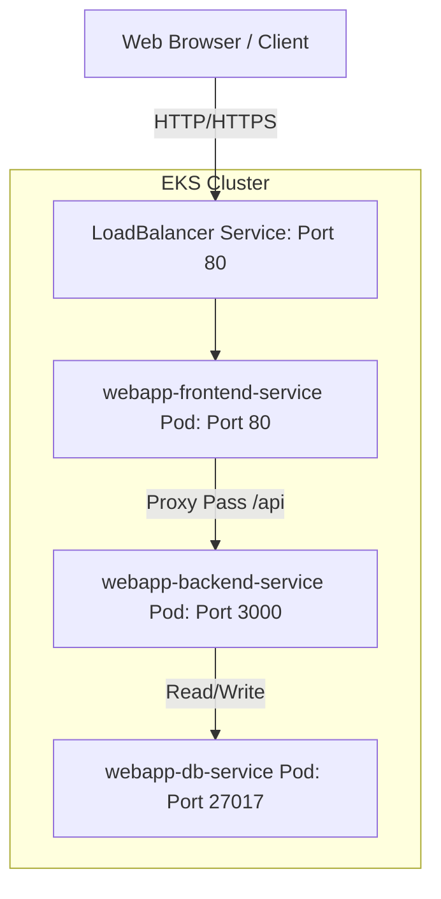
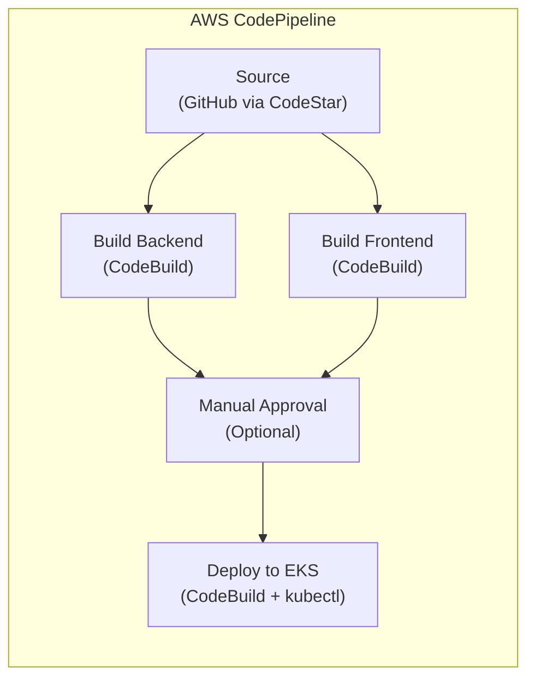

# EKS & GitOps Multi-Service Application Deployment

This repository contains the infrastructure, manifests, and source code to configure, deploy, and manage a complete multi-service web application on a managed AWS EKS cluster. The application is composed of three interconnected services:

1. **Database Service (`webapp-db-service`)**: An internal MongoDB database instance utilizing the official Docker Hub image.
2. **Backend Service (`webapp-backend-service`)**: A Node.js Express API that processes user records and stores them in MongoDB.
3. **Frontend Service (`webapp-frontend-service`)**: A React web application served by an Nginx server, configured to reverse-proxy `/api` requests to the backend service.

---

## Architecture Overview



---

## DevOps Toolchain

We leverage a modern, robust DevOps toolchain to package, deploy, automate, and monitor this multi-service application:

| Tool | Badge | Role & Usage in Project |
| :--- | :---: | :--- |
| **AWS EKS** |  | **Managed Container Orchestration**: Hosts the entire production cluster, managing the lifecycle and scaling of all application pods in a secure, AWS-managed environment. |
| **Kubernetes** |  | **Orchestration Engine**: Handles core resource declarations like Deployments, internal and external Services, and state synchronization across the cluster. |
| **GitHub Actions** |  | **CI/CD Automation**: Automatically builds, tags, and pushes Docker images to ECR, and deploys manifest updates directly to the EKS cluster on push events. |
| **AWS CodePipeline** |  | **AWS-Native CI/CD**: An alternative pipeline that orchestrates Source → Build → Approval → Deploy stages entirely within the AWS ecosystem, provisioned via Terraform. |
| **AWS CodeBuild** |  | **Managed Build Service**: Compiles Docker images for the backend and frontend services, pushes them to ECR, and executes `kubectl` deployments to the EKS cluster. |
| **Docker** |  | **Containerization**: Packages the frontend React app and backend Node.js APIs into isolated, lightweight, lightweight container images. |
| **AWS ECR** |  | **Container Registry**: Provides secure, private registries to host and manage our built frontend and backend Docker images. |
| **Terraform** |  | **Infrastructure as Code**: Provisions the full EKS cluster, VPC, subnets, NAT Gateway, managed node group, and CodePipeline CI/CD resources declaratively — enabling reproducible, version-controlled infrastructure. |
| **Helm** |  | **Kubernetes Package Manager**: Simplifies the deployment, version control, and management of the complex Prometheus and Grafana monitoring stack using predefined charts. |
| **Prometheus** |  | **Metrics & Monitoring**: Automatically scrapes real-time application metrics (including custom API response latency histograms and runtime stats) from annotated pods. |
| **Grafana** |  | **Data Visualization**: Provides rich interactive dashboards to monitor API latencies, CPU/Memory resource utilization, and overall cluster health. |

---

## Step 1: Install Required Tools

Ensure the following tools are installed on your local machine:
- [AWS CLI](https://docs.aws.amazon.com/cli/latest/userguide/getting-started-install.html) (configured with appropriate credentials)
- [kubectl](https://kubernetes.io/docs/tasks/tools/install-kubectl/) (matching your cluster version)
- [eksctl](https://docs.aws.amazon.com/eks/latest/userguide/eksctl.html) (AWS EKS CLI — required for Method A)
- [Terraform](https://developer.hashicorp.com/terraform/install) `>= 1.6.0` (required for Method B)
- [Helm](https://helm.sh/docs/intro/install/) (Kubernetes package manager)

### Installing Helm
Select the appropriate package manager for your operating system:
* **Windows (winget)**: `winget install Helm.Helm` (restart terminal after installation)
* **Windows (Chocolatey)**: `choco install kubernetes-helm`
* **macOS (Homebrew)**: `brew install helm`
* **Linux (Debian/Ubuntu)**: `sudo apt-get install helm`

### Installing Terraform
Select the appropriate package manager for your operating system:
* **Windows (winget)**: `winget install Hashicorp.Terraform`
* **Windows (Chocolatey)**: `choco install terraform`
* **macOS (Homebrew)**: `brew tap hashicorp/tap && brew install hashicorp/tap/terraform`
* **Linux**: See the [official install guide](https://developer.hashicorp.com/terraform/install#linux)

### Verify Installations
```bash
aws --version
kubectl version --client
eksctl version
terraform version
helm version
```

### AWS Credentials Configuration
```bash
aws configure
```

---

## Step 2: Create AWS ECR Repositories

Create private Elastic Container Registries (ECR) in your preferred region (e.g., `ap-south-1`) to host your backend and frontend application images.

### 1. Create Backend Repository
```bash
aws ecr create-repository --repository-name webapp-backend-service --region ap-south-1
```

### 2. Create Frontend Repository
```bash
aws ecr create-repository --repository-name webapp-frontend-service --region ap-south-1
```

*Note: We do not need a custom ECR repository for the database as EKS pulls MongoDB directly from the public Docker Hub.*

---

## Step 3: Spin Up EKS Cluster

> **Choose one of the two methods below** to provision your EKS cluster. Both methods produce an identical cluster configuration.

---

### Method A — eksctl (Quick CLI)

Use `eksctl` to provision a production-ready managed EKS cluster in a single command.

```bash
eksctl create cluster --name mycluster --region ap-south-1 --nodegroup-name standard --node-type t2.medium --nodes 3 --managed
```

*This process provisions a VPC, EKS Control Plane, worker node autoscaling group, and IAM roles. Execution takes approximately 15–20 minutes.*

#### Configure local kubeconfig
```bash
eksctl utils write-kubeconfig --cluster mycluster --region ap-south-1
```

#### Verify Node Status
```bash
kubectl get nodes
```

---

### Method B — Terraform (Infrastructure as Code) ✨

The [`terraform-eks/`](./terraform-eks/) directory contains a fully declarative Terraform configuration that provisions the **same cluster** as the eksctl command above, using the official AWS Terraform modules. This approach gives you versioned, repeatable, and auditable infrastructure.

#### What gets provisioned

| Resource | Details |
| :--- | :--- |
| **VPC** | `/16` CIDR with 3 public + 3 private subnets across AZs |
| **NAT Gateway** | Single NAT Gateway for private subnet egress |
| **EKS Cluster** | Kubernetes `1.29`, public + private API endpoint |
| **Managed Node Group** | `t2.medium` × 3 nodes (`standard` group) |
| **Cluster Add-ons** | CoreDNS, kube-proxy, VPC CNI, EBS CSI Driver |

#### Files Overview

```
terraform-eks/
├── main.tf           # VPC + EKS modules, provider configuration
├── variables.tf      # All configurable input variables with defaults
├── outputs.tf        # Key cluster attributes exposed after apply
└── terraform.tfvars  # Default values (edit to customise)
```

#### Prerequisites

Install [Terraform CLI](https://developer.hashicorp.com/terraform/install) `>= 1.6.0`:
```bash
# Windows (winget)
winget install Hashicorp.Terraform

# macOS (Homebrew)
brew tap hashicorp/tap && brew install hashicorp/tap/terraform

# Verify
terraform version
```

#### 1. Initialise — download providers & modules
```bash
cd terraform-eks
terraform init
```

#### 2. Preview the execution plan
```bash
terraform plan
```

#### 3. Apply — provision the cluster (~20 minutes)
```bash
terraform apply
```

Type `yes` when prompted to confirm resource creation.

#### 4. Configure local kubeconfig

After `apply` completes, run the output command to update your local `~/.kube/config`:
```bash
# The exact command is printed by Terraform as the `kubeconfig_command` output
aws eks update-kubeconfig --region ap-south-1 --name mycluster
```

#### 5. Verify Node Status
```bash
kubectl get nodes
```

#### Customising Variables

Edit [`terraform-eks/terraform.tfvars`](./terraform-eks/terraform.tfvars) to change any default value:

```hcl
# Example: switch to a larger instance type and more nodes
node_instance_type = "t3.large"
node_desired_size  = 5
node_max_size      = 10
```

#### Destroying the cluster with Terraform
```bash
cd terraform-eks
terraform destroy
```

---

## Step 4: Build & Push Images to ECR

Before deploying to EKS, compile the Docker images locally and push them to ECR.

### 1. Log In to ECR
```bash
aws ecr get-login-password --region ap-south-1 | docker login --username AWS --password-stdin 485031388770.dkr.ecr.ap-south-1.amazonaws.com
```

### 2. Build & Push Backend Service
```bash
# Build
docker build -t webapp-backend-service ./multi-service-app/webapp-backend-service

# Tag
docker tag webapp-backend-service:latest 485031388770.dkr.ecr.ap-south-1.amazonaws.com/webapp-backend-service:latest

# Push
docker push 485031388770.dkr.ecr.ap-south-1.amazonaws.com/webapp-backend-service:latest
```

### 3. Build & Push Frontend Service
```bash
# Build
docker build -t webapp-frontend-service ./multi-service-app/webapp-frontend-service

# Tag
docker tag webapp-frontend-service:latest 485031388770.dkr.ecr.ap-south-1.amazonaws.com/webapp-frontend-service:latest

# Push
docker push 485031388770.dkr.ecr.ap-south-1.amazonaws.com/webapp-frontend-service:latest
```

---

## Step 5: Deploy to EKS Cluster

Apply the Kubernetes manifests in the order of their dependencies (Database -> Backend -> Frontend).

```bash
# 1. Deploy MongoDB database service
kubectl apply -f kubernetes-deployment/deploy-db-service.yml

# 2. Deploy backend service
kubectl apply -f kubernetes-deployment/deploy-backend-service.yml

# 3. Deploy frontend service (LoadBalancer)
kubectl apply -f kubernetes-deployment/deploy-frontend-service.yml
```

### Monitor Resource Rollout
```bash
kubectl get all
```

---

## Step 6: Verify and Access the Application

Once all pods are running, the frontend application is exposed via an AWS Elastic Load Balancer.

### 1. Retrieve the LoadBalancer Endpoint
```bash
kubectl get svc webapp-frontend-service
```
Locate the `EXTERNAL-IP` value (e.g., `a0106be3e37dc4ae3b0ce7dba5915ee1-61199676.ap-south-1.elb.amazonaws.com`).

### 2. Test Frontend Delivery
Open your browser or run:
```bash
curl -I http://<EXTERNAL-IP>/
```

### 3. Verify End-to-End API Integration
To verify that the Nginx proxy, backend, and MongoDB database are working seamlessly together, add a record to the database:

```bash
# Windows (PowerShell)
Invoke-RestMethod -Uri "http://<EXTERNAL-IP>/api/user" -Method Post -Body '{"name":"John Doe","age":30}' -ContentType "application/json"

# Linux / MacOS (Bash)
curl -X POST -H "Content-Type: application/json" -d '{"name":"John Doe","age":30}' http://<EXTERNAL-IP>/api/user
```

Retrieve the user list to confirm persistence:
```bash
# Windows (PowerShell)
Invoke-RestMethod -Uri "http://<EXTERNAL-IP>/api/user"

# Linux / MacOS (Bash)
curl http://<EXTERNAL-IP>/api/user
```

---

## Step 7: Integrate Monitoring (Prometheus & Grafana)

Collect cluster, node, and pod metrics dynamically and visualize them in a Grafana dashboard.

### Application-Level Metrics Integration
The backend Node.js service (`webapp-backend-service`) is integrated with `prom-client` to expose application-level metrics at `/metrics` on port `3000`.

- **Runtime Metrics**: Collects memory usage, CPU load, garbage collection, event loop lag, and process metrics.
- **Custom HTTP Metrics**: Tracks HTTP request latency and counts.
  - `http_request_duration_seconds` (Histogram): Labeled by `method`, `route`, and `status_code` to measure API response times.

### 1. Deploy the Monitoring Stack using Helm
Use Helm along with the custom values file provided in [prometheus-grafana-values.yml](file:///d:/cloudtrain-projects/cloudtrain-cicd-kubernetes-project/kubernetes-monitoring/prometheus-grafana-values.yml):

```bash
# Add the helm repo
helm repo add prometheus-community https://prometheus-community.github.io/helm-charts
helm repo update

# Install the stack in a dedicated 'monitoring' namespace
helm install prometheus prometheus-community/kube-prometheus-stack --namespace monitoring --create-namespace -f kubernetes-monitoring/prometheus-grafana-values.yml
```

This will automatically:
- Deploy Prometheus server and Grafana.
- Configure Grafana as a `LoadBalancer` service to make it publicly accessible.
- Activate the Prometheus Pod Autodiscover scrape rule targeting pods with `prometheus.io/scrape` annotations (already configured in the backend deployment, which scrapes `/metrics` on port `3000`).

### 2. Access the Grafana UI
Retrieve the external DNS/IP of Grafana:
```bash
kubectl get svc prometheus-grafana --namespace monitoring
```

Open your browser and navigate to the external endpoint:
- **Username**: `admin`
- **Password**: `AdminSecurePassword123!` (as configured in the values file)

### 3. Querying Application Metrics in Prometheus / Grafana
Once the backend service is running and receiving traffic, you can monitor its performance in Grafana using PromQL. 

#### Useful Metrics and Queries:
- **Total Requests Rate**:
  ```promql
  sum(rate(http_request_duration_seconds_count[5m])) by (route, method, status_code)
  ```
- **95th Percentile Response Latency**:
  ```promql
  histogram_quantile(0.95, sum(rate(http_request_duration_seconds_bucket[5m])) by (le, route))
  ```
- **Node.js Memory Usage**:
  ```promql
  nodejs_heap_size_used_bytes / nodejs_heap_size_total_bytes * 100
  ```

---

## Step 8: CI/CD with AWS CodePipeline (Alternative to GitHub Actions) ✨

As an alternative to the GitHub Actions workflows, this project includes a fully **AWS-native CI/CD pipeline** using **AWS CodePipeline** and **AWS CodeBuild**, provisioned entirely via Terraform.

### Pipeline Architecture



| Stage | Action | Description |
| :--- | :--- | :--- |
| **Source** | GitHub (CodeStar Connection) | Detects pushes to the configured branch and pulls the source code |
| **Build** | CodeBuild (parallel) | Builds backend and frontend Docker images simultaneously, pushes both to ECR |
| **Approval** | Manual Approval (optional) | Pauses the pipeline for human review before deployment |
| **Deploy** | CodeBuild + kubectl | Applies all K8s manifests to EKS and performs rolling restarts |

### What Gets Provisioned

| Resource | Details |
| :--- | :--- |
| **CodeStar Connection** | GitHub v2 source connection |
| **S3 Bucket** | Encrypted artifact store with versioning |
| **IAM Roles** | Least-privilege roles for CodePipeline and CodeBuild |
| **CodeBuild Projects (×3)** | Backend build, frontend build, EKS deploy |
| **CodePipeline** | 4-stage pipeline (Source → Build → Approval → Deploy) |

### Files Overview

```
codepipeline/
├── buildspec-backend.yml    # Build + push backend Docker image
├── buildspec-frontend.yml   # Build + push frontend Docker image
└── buildspec-deploy.yml     # Deploy all K8s manifests to EKS

terraform-codepipeline/
├── main.tf                  # All pipeline AWS resources
├── variables.tf             # Configurable input variables
├── outputs.tf               # Pipeline ARN, bucket, console URL
└── terraform.tfvars         # Default values (edit to customise)
```

### Prerequisites

- An existing EKS cluster (provisioned via Step 3)
- ECR repositories created (Step 2)
- Terraform CLI `>= 1.6.0` installed
- AWS credentials configured with sufficient permissions

### 1. Customise Variables

Edit [`terraform-codepipeline/terraform.tfvars`](./terraform-codepipeline/terraform.tfvars) with your GitHub repository details:

```hcl
github_repo_id = "your-org/cloudtrain-cicd-kubernetes-project"   # ← your GitHub owner/repo
github_branch  = "main"

# Set to false to deploy automatically without manual approval
enable_manual_approval = true
```

### 2. Initialise Terraform
```bash
cd terraform-codepipeline
terraform init
```

### 3. Preview the Execution Plan
```bash
terraform plan
```

### 4. Apply — Provision the Pipeline
```bash
terraform apply
```

Type `yes` when prompted. Provisioning completes in approximately 1–2 minutes.

### 5. Authorise the CodeStar Connection (One-Time)

> **Important**: After `terraform apply`, the CodeStar connection is created in a `PENDING` state. You must complete the connection manually:

1. Open the [AWS CodePipeline Console → Settings → Connections](https://console.aws.amazon.com/codesuite/settings/connections)
2. Find the connection named `cloudtrain-webapp-github`
3. Click **"Update pending connection"**
4. Authorise access to your GitHub account and select the repository
5. The connection status will change to **Available**

### 6. Verify the Pipeline

Once the connection is authorised, the pipeline will trigger automatically on the next push to the configured branch. You can also manually release a change:

```bash
# View the pipeline console URL from Terraform outputs
terraform output pipeline_console_url
```

Or trigger a release via the AWS CLI:
```bash
aws codepipeline start-pipeline-execution --name cloudtrain-webapp-pipeline --region ap-south-1
```

### 7. Grant CodeBuild Access to EKS

The CodeBuild deploy role needs Kubernetes RBAC permissions. Add its IAM role to the EKS `aws-auth` ConfigMap:

```bash
# Get the CodeBuild role ARN
CODEBUILD_ROLE=$(aws iam get-role --role-name cloudtrain-webapp-codebuild-role --query 'Role.Arn' --output text)

# Patch the aws-auth ConfigMap
kubectl edit configmap aws-auth -n kube-system
```

Add the following entry under `mapRoles`:
```yaml
- rolearn: <CODEBUILD_ROLE_ARN>
  username: codebuild-deploy
  groups:
    - system:masters
```

### Customising Variables

All pipeline behaviour is configurable via [`terraform-codepipeline/terraform.tfvars`](./terraform-codepipeline/terraform.tfvars):

```hcl
# Switch target cluster
eks_cluster_name = "production-cluster"

# Use a different ECR registry
ecr_registry = "123456789012.dkr.ecr.us-east-1.amazonaws.com"

# Disable the manual approval gate
enable_manual_approval = false
```

### Destroying the Pipeline
```bash
cd terraform-codepipeline
terraform destroy
```

Type `yes` when prompted. This removes the pipeline, CodeBuild projects, IAM roles, and the S3 artifact bucket.

---

## Step 9: Clean Up EKS Resources

To avoid incurring ongoing charges for active EC2 nodes and LoadBalancers, delete the cluster when finished using the method that matches how you provisioned it.

### If you used eksctl (Method A)
```bash
eksctl delete cluster --name mycluster --region ap-south-1
```

### If you used Terraform (Method B)

Terraform tracks all resources it created in `terraform.tfstate`, so a single command tears everything down cleanly — including the VPC, subnets, NAT Gateway, node group, and the EKS control plane:

```bash
cd terraform-eks
terraform destroy
```

Type `yes` when prompted to confirm deletion. The operation takes approximately 10–15 minutes.

> **Note**: Always run `terraform destroy` from the same directory where you ran `terraform apply`, so Terraform can read the state file and know exactly which resources to remove.